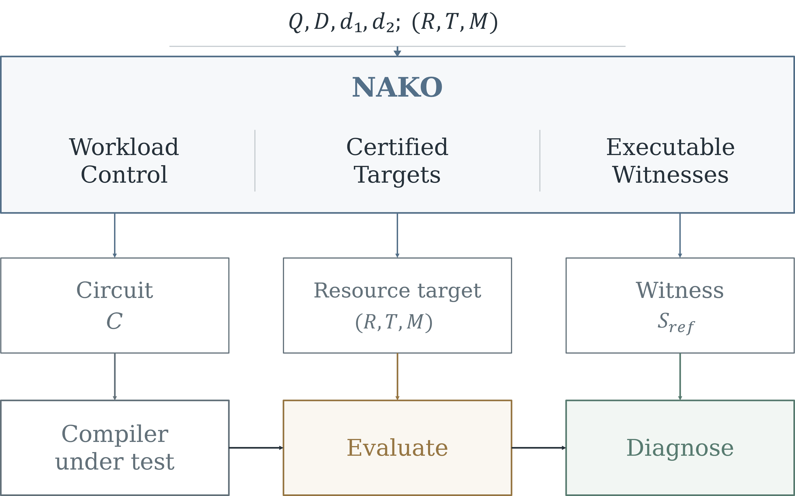

# NAKO

NAKO constructs parameterized neutral-atom circuits with attainable resource
targets and executable reference schedules. Resources are Rydberg stages (R),
routing intervals (T), and movement layers (M).



## Installation and use

Python 3.10 or later is required.

```bash
python -m pip install .
python -m nako examples/benchmark.json --output generated --count 1
```

Each variant contains `circuit.qasm`, `config.json`, `reference.json`, and
`generation_record.json`.

```python
from nako import generate

benchmark = generate(
    qubits=20, depth=30, rtm=(16, 12, 18),
    densities=(0.4, 0.4), grid=(16, 16), seed=7,
)[0]
benchmark.save("generated/example")
enola_mapping = benchmark.initial_mapping("enola", (16, 16, 16, 16))
dpqa_mapping = benchmark.initial_mapping("olsq-dpqa", (16, 16, 16, 16))
```

The Python interface exposes the Qiskit circuit, reference operations, achieved
counts, and compiler-specific initial mappings. Mapping dimensions are
`(n_x, n_y, n_c, n_r)`.

## Parameters

- `qubits`: register size, at least eight.
- `depth`: logical depth, at least R.
- `rtm`: integer targets satisfying T <= M <= 3T/2 and R >= T + 1.
- `densities`: requested single- and two-qubit gate densities in [0, 1].
- `grid`: site rows and columns, with at least eight columns and capacity
  `2 * rows * columns - 8`.
- `seed`: nonnegative random seed; `count` selects the number of variants.
- `variant`: starting index in the seeded sequence, default zero.

Static filler preserves the resource targets. Achieved gate counts and deviations
from the requested densities are recorded in `generation_record.json`.
Reference locations use `(row, column, slot)`, with slots zero and one.

## Results

The `results` directory contains the evaluation measurements, compiled schedules,
and diagnostic results accompanying *NAKO: A Benchmarking Framework for Evaluating
and Diagnosing Neutral-Atom Quantum Compilers*. Its file schema and experiment
index are described in [results/README.md](results/README.md).
